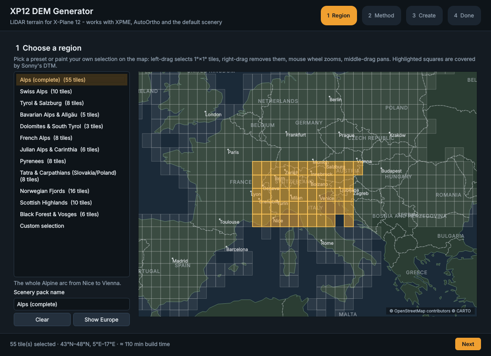
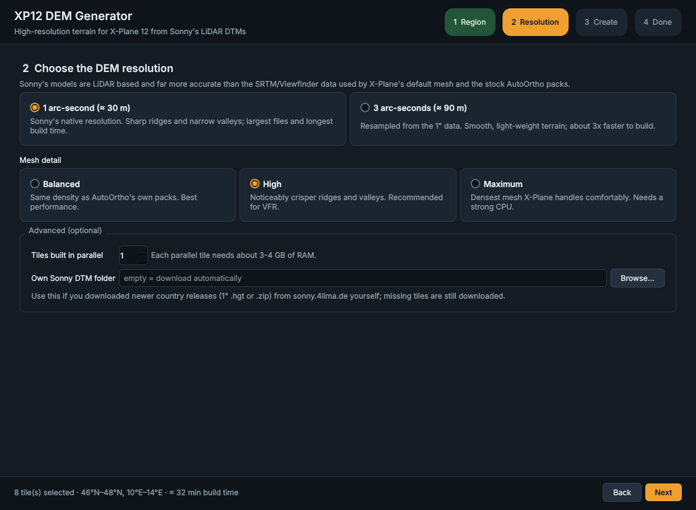
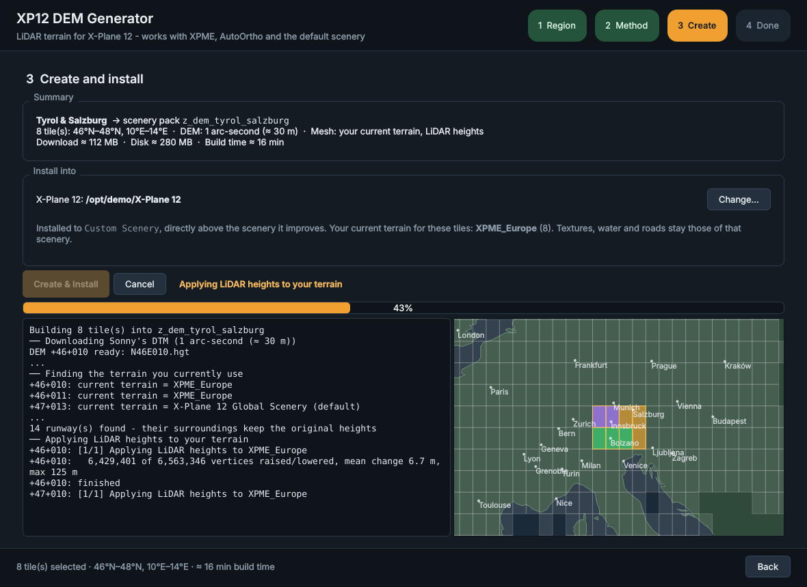
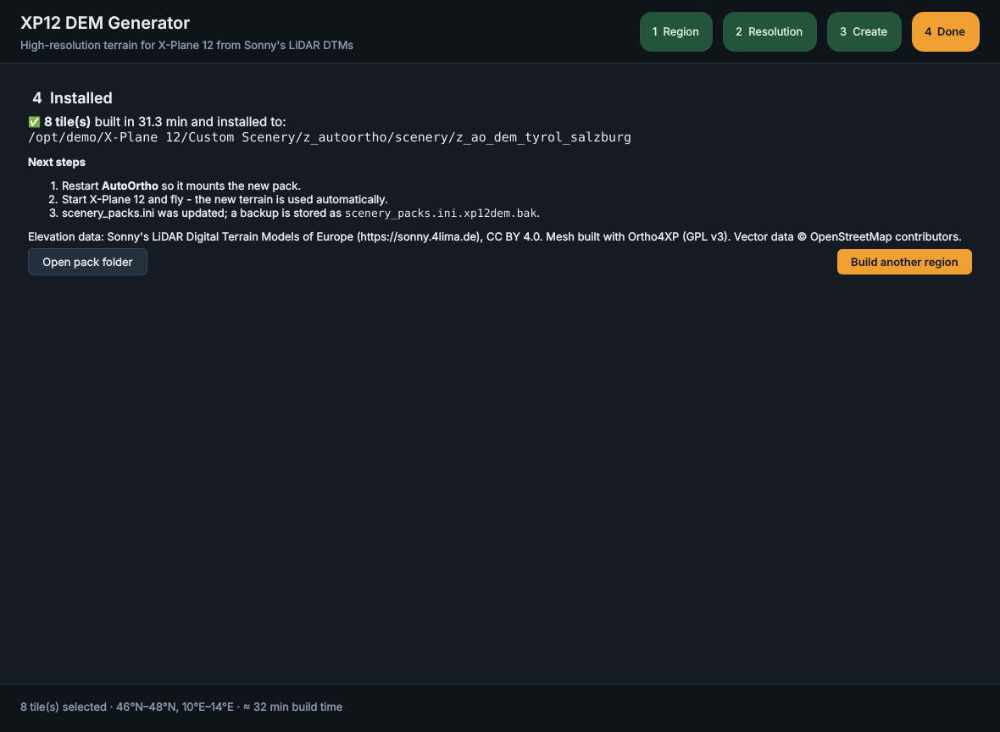

# XP12 DEM Generator

**High-resolution LiDAR terrain for X-Plane 12 in a few clicks — made for AutoOrtho users.**

XP12 DEM Generator downloads [Sonny's LiDAR Digital Terrain Models of Europe](https://sonny.4lima.de),
turns them into X-Plane 12 terrain meshes with [Ortho4XP](https://github.com/oscarpilote/Ortho4XP)
(running invisibly in the background) and installs the result so that
[AutoOrtho](https://github.com/ProgrammingDinosaur/autoortho4xplane) keeps streaming the
photo textures on top. No Ortho4XP configuration, no copying folders, no editing
`scenery_packs.ini`.

| 1. Choose a region | 2. Choose the DEM resolution |
|---|---|
|  |  |
| **3. Create & install** | **4. Done** |
|  |  |

## Why?

The stock AutoOrtho scenery packs (and X-Plane's default mesh) are built from
Viewfinder Panoramas / SRTM elevation data — 30 m in the Alps, 90 m in most other
places, with radar artefacts in steep terrain. Sonny's models are compiled from
official airborne-laser-scan (LiDAR) surveys and are far more accurate, especially
on sharp ridges, in narrow valleys and in forests. For VFR flying through the
mountains the difference is very visible.

## Quick start (Windows 10/11)

1. Make sure **AutoOrtho** (or AutoOrtho Continued) is installed and has been started at
   least once, so its `X-Plane` and `Custom Scenery` paths are configured.
2. Download `XP12DEMGenerator-windows.zip` from the
   [latest release](../../releases/latest) (or from the newest successful
   [build run](../../actions) → *Artifacts*), unzip it anywhere and start
   **`XP12DEMGenerator.exe`**.
3. **Region** — pick a preset (Alps, Swiss Alps, Tyrol, Dolomites, Pyrenees, Norway…) or paint
   your own 1°×1° tiles on the map.
4. **Resolution** — choose 1″ (≈30 m, maximum detail) or 3″ (≈90 m, light) and a mesh detail level.
5. **Create** — click *Create & Install*. The app downloads the DEM tiles, builds
   every tile and installs the pack.
6. Restart AutoOrtho, start X-Plane 12 and fly.

The app needs an internet connection (DEM from GitHub, OpenStreetMap data from the
Overpass API). A 1°×1° tile takes roughly 2–6 minutes depending on the settings and your CPU.

## What gets installed where

* The pack is called `z_ao_dem_<your-region>` and contains only terrain
  (`Earth nav data/*.dsf`, `terrain/*.ter`, water masks). The photo textures it
  references (`textures/<row>_<col>_BI16.dds`, ZL16 with ZL18 around airports) are
  exactly the names AutoOrtho generates on the fly.
* **AutoOrtho mode (recommended):** the pack is copied to
  `<AutoOrtho scenery path>/z_autoortho/scenery/`. AutoOrtho mounts every folder there
  into X-Plane's `Custom Scenery` on start-up — just like its own `z_ao_eur` pack.
* **Custom Scenery mode:** the pack is copied straight into `X-Plane 12/Custom Scenery`.
  Only useful if you serve the textures some other way.
* `Custom Scenery/scenery_packs.ini` is updated so the new pack sits **directly above**
  `z_ao_*` / other Ortho4XP meshes. X-Plane only uses the first base mesh it finds for
  a tile, so this is what makes the new terrain win. A backup is written to
  `scenery_packs.ini.xp12dem.bak`.
* Building the same pack name again adds new tiles and replaces rebuilt ones.
* Work files (DEM cache, OSM cache, logs) live in `%LOCALAPPDATA%\XP12DEMGenerator`.
  Delete that folder to reclaim disk space; set the `XP12DEM_DATA` environment variable
  to move it.

## Options explained

| Option | Values | Notes |
|---|---|---|
| DEM resolution | **1″** (≈30 m) · **3″** (≈90 m) | 3″ is resampled from Sonny's 1″ data (3×3 mean). |
| Mesh detail | **Balanced** · **High** · **Maximum** | Ortho4XP `curvature_tol` 2.0 / 1.2 / 0.8 and `limit_tris` 3 / 4 / 5 M triangles per tile. *Balanced* matches the stock AutoOrtho packs, *High* is a good VFR default. |
| Tiles in parallel | 1 – 8 | Each Ortho4XP worker needs about 2–3 GB of RAM (measured: 2.0 GB peak for a 1″ *Maximum* tile with 4.5 M triangles). |
| Own Sonny DTM folder | optional | Point it at `.hgt` or `.zip` files you downloaded from sonny.4lima.de (e.g. newer country releases). Missing tiles are downloaded automatically. |

The XP12-specific parts are handled for you: water uses Ortho4XP's *XP12* water
technology, and the elevation/bathymetry rasters of the X-Plane 12 Global Scenery are
copied into each new DSF (the app unpacks the 7-Zip compressed Global Scenery DSFs itself).

## Data sources

* **Elevation:** Sonny's LiDAR DTM Europe, 1″, v24 (CC BY 4.0). Because the original site
  distributes whole countries via Google Drive, tiles are fetched one by one from the
  public mirror [mg4gh/hgtdata](https://github.com/mg4gh/hgtdata). The map shows which
  tiles are available (1,056 tiles, from Iceland and Svalbard to Cyprus).
* **Vectors:** water bodies, coastline, airports and roads from OpenStreetMap via Overpass.

## Command line

The same pipeline is available without the GUI:

```
XP12DEMGenerator.exe build --region tyrol --resolution 1 --mesh high
XP12DEMGenerator.exe build --tiles +46+007,+46+008 --name "Valais" --parallel 2
```

Run `XP12DEMGenerator.exe build --help` for all options (`--xplane`, `--target`,
`--dem-folder`, `--no-install`).

## Building from source

```
python -m venv .venv
.venv\Scripts\activate           # Linux/macOS: source .venv/bin/activate
pip install -r requirements-dev.txt
python -m xp12dem                # start the GUI
python -m pytest                 # run the tests
pyinstaller --noconfirm packaging/xp12dem.spec   # -> dist/XP12DEMGenerator/
```

The app also runs on Linux (Ortho4XP's Linux binaries are included). Every push builds
and smoke-tests the Windows executable with GitHub Actions; tags `v*` publish a release.

### How it works

```
xp12dem/
  gui/            PySide6 wizard (map widget, 4 steps)
  regions.py      presets and 1°×1° tile helpers
  dem.py          Sonny DTM download, validation, 3″ resampling
  pipeline.py     orchestration: DEM → Ortho4XP per tile → pack → install
  o4x_worker.py   runs Ortho4XP headless in its own process (one per tile)
  installer.py    pack assembly, AutoOrtho / Custom Scenery install, scenery_packs.ini
  xplane.py       X-Plane 12 and AutoOrtho detection
third_party/Ortho4XP   unmodified Ortho4XP sources + Triangle4XP / DSFTool / 7-Zip
```

Each tile is built by a separate `xp12dem-worker` process that configures Ortho4XP
(Sonny DEM as `custom_dem`, imagery download disabled, XP12 water, masks as separate
PNGs for AutoOrtho), then runs Ortho4XP's normal steps: vector data → Triangle4XP
mesh → masks → DSF.

## Troubleshooting

* **"AutoOrtho (not found)"** — start AutoOrtho once and set its X-Plane / scenery paths;
  the app reads them from `%USERPROFILE%\.autoortho`.
* **Tiles show no photos** — AutoOrtho is not running or was not restarted after the install.
* **Old terrain still visible** — check that `z_ao_dem_…` is listed above `z_ao_eur` in
  `Custom Scenery\scenery_packs.ini`.
* **OSM download is slow / fails** — the public Overpass servers are sometimes busy; the
  app rotates through six servers and gives up after 10 minutes per query with a clear
  message. Just run the build again later — finished downloads are cached.
* Detailed per-tile logs: `%LOCALAPPDATA%\XP12DEMGenerator\logs`.

## Credits and licenses

* Elevation data © Sonny, https://sonny.4lima.de — CC BY 4.0
* Ortho4XP © Oscar Pilote and contributors — GPL v3 (vendored in `third_party/Ortho4XP`)
* Map data © OpenStreetMap contributors — ODbL; map background: Natural Earth
* XP12 DEM Generator source code — MIT (see `LICENSE`). Binary releases bundle Ortho4XP and
  are therefore distributed under the GPL v3. Details in `THIRD_PARTY_NOTICES.md`.

Not affiliated with Laminar Research, Sonny, AutoOrtho or Ortho4XP.
