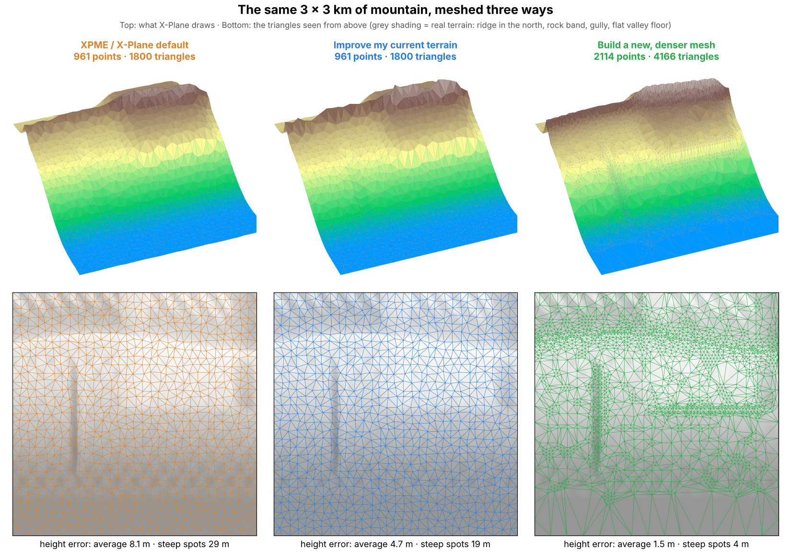
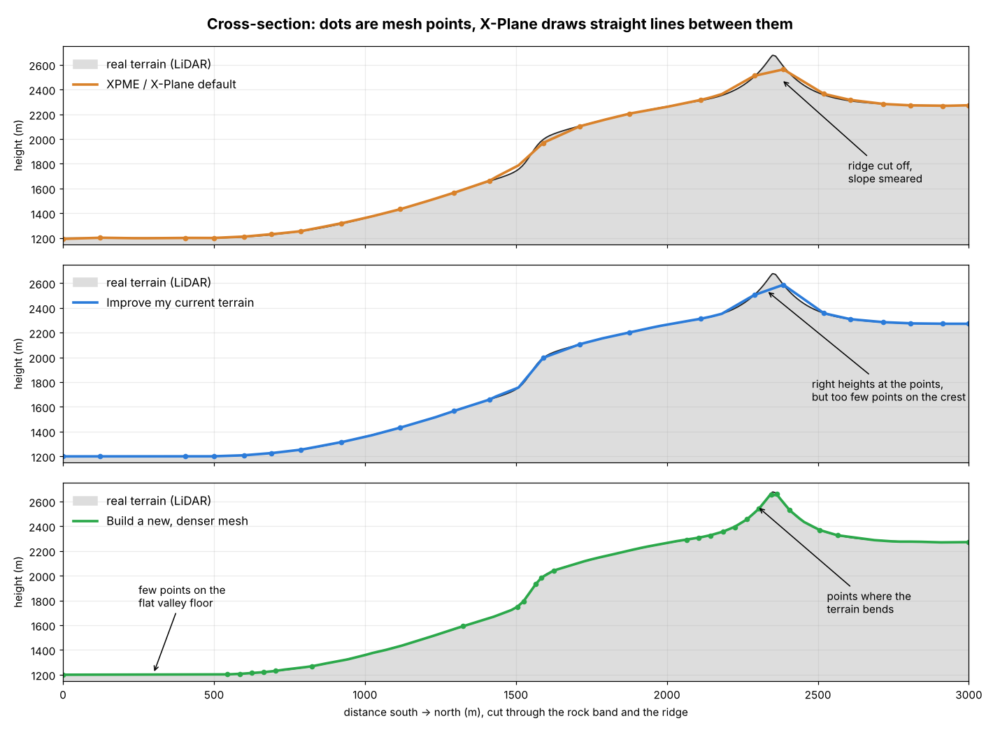
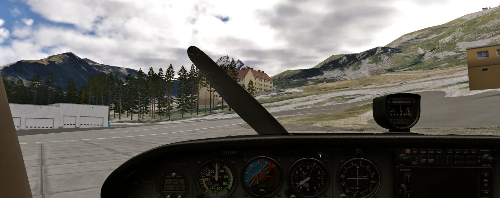
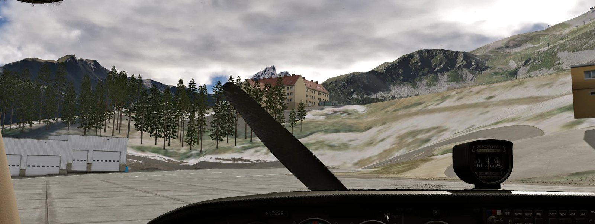
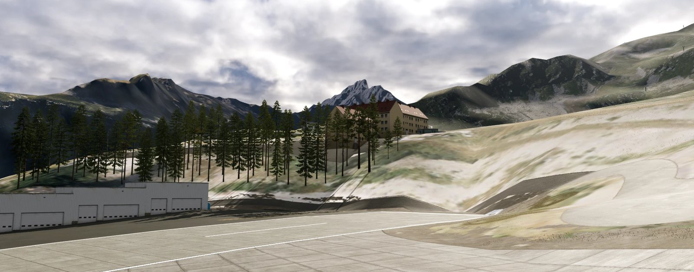
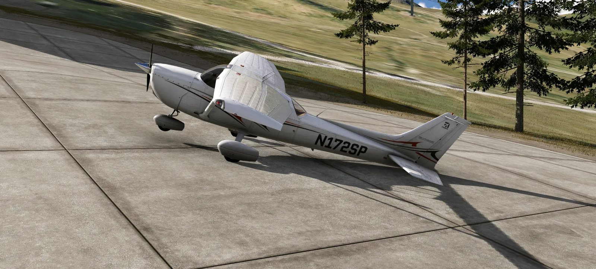
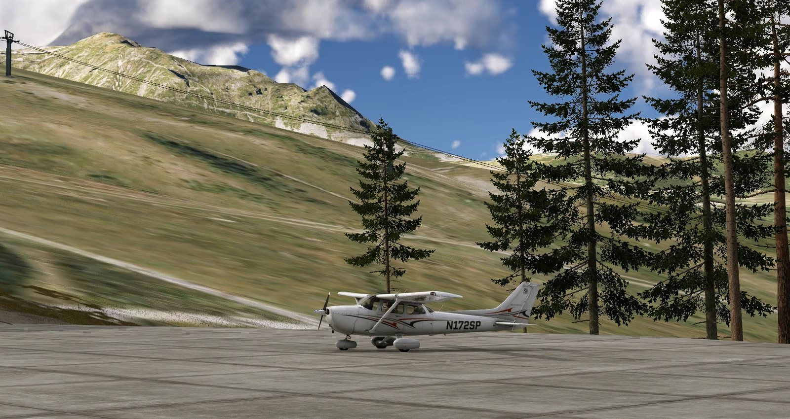
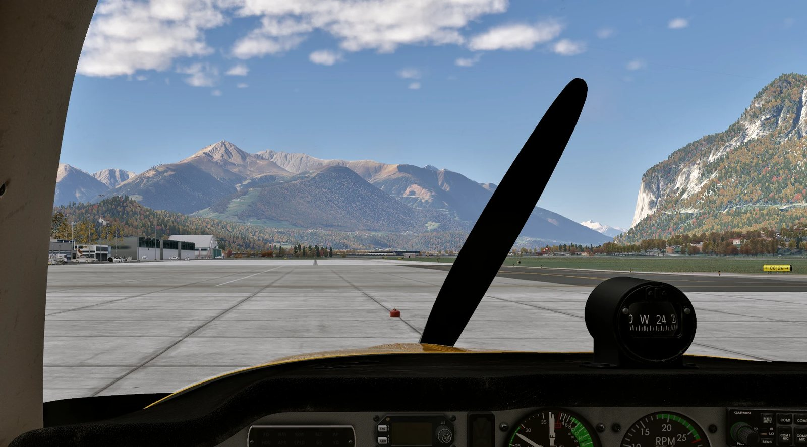

# XP12 DEM Generator

**Sharper, more accurate mountains for X-Plane 12 — built from laser-scan (LiDAR) elevation
data, installed in a few clicks, working together with XPME, AutoOrtho or the default scenery.**

A free Windows app (also runs on Linux) for private use. It downloads the best free elevation
data for the area you pick — LiDAR surveys for most of the Alps and Europe, USGS 3DEP for the
USA, and more — and turns it into X-Plane terrain. No Ortho4XP knowledge, no copying folders, no
editing `scenery_packs.ini`.

| 1. Choose a region | 2. Choose method and DEM resolution |
|---|---|
|  |  |
| **3. Create & install** | **4. Done** |
|  |  |

---

## The problem: X-Plane's mountains are soft and coarse

X-Plane draws the ground as a **mesh of triangles**. Every corner of a triangle (a *point* or
*vertex*) has a height; between the points X-Plane draws flat triangle faces. How good the
mountains look depends on two things:

1. **How accurate the heights are.** X-Plane's default scenery, XPME's base packages and the stock
   AutoOrtho packs are built from 30–90 m satellite elevation data (SRTM, Viewfinder Panoramas
   and similar radar-based models).
   Radar data is blurred: knife-edge ridges come out rounded and too low, cliffs become slopes,
   narrow gullies disappear, forests add a few metres.
2. **Where the points are.** These meshes spread their points fairly **evenly**, roughly every
   50–100 m — on the flat valley floor just as on a ridge. Whatever happens *between* two points
   (a crest, the edge of a rock band) is lost, however good the data is.

Laser scans (LiDAR) measure the bare ground to a few decimetres. This app brings that data into
X-Plane in one of two ways.

## The two options compared with XPME / default





*A generic, made-up 3 × 3 km mountain slope (drawn by
[`packaging/make_readme_figures.py`](packaging/make_readme_figures.py)). The point counts follow
what was measured on a real tile: around Innsbruck XPME's mesh has 1.6 million triangles per
1°×1° tile, the new mesh at "High" detail 3.6 million.*

| | **XPME / X-Plane default** | **Improve my current terrain** | **Build a new, denser mesh** |
|---|---|---|---|
| Points of the mesh | evenly spread, ~50–100 m apart | **the same points** as XPME | **new points**, placed where the terrain bends: dense on ridges, cliffs and gullies, sparse on flat ground |
| Heights | satellite radar, blurred | **LiDAR** at every point | **LiDAR** at every point |
| Ridges, rock bands | rounded, cut off | correct where a point sits, still cut between points | sharp |
| Photos | XPME / AutoOrtho | unchanged (XPME / AutoOrtho) | **XPME's** or AutoOrtho's photos, same tiling |
| Water, coastline, roads | XPME / X-Plane | unchanged | rebuilt from OpenStreetMap |
| Airports | flattened by XPME / X-Plane | unchanged (heights around runways are kept) | runways follow their real, smoothed profile (Courchevel stays steep); aprons are laid level |
| Build time per 1°×1° tile | — | ~2 min | ~10–25 min |
| Disk per tile | — | ~100 MB | ~50 MB (1″, High) |
| Installed as | — | `z_dem_<region>` | `z_dem_mesh_<region>` |

**Which one should I use?**

* **Build a new, denser mesh** where you actually fly in the mountains — this is where LiDAR
  shows its full detail. Pick *1″* resolution and *High* mesh detail; with your own 10 m data
  (see below) *1/3″*.
* **Improve my current terrain** for large areas around it: in minutes per tile you get correct
  heights everywhere while keeping XPME's water, roads and airport flattening.
* Both can be installed at the same time. Where a tile exists in both, the new mesh wins (it is
  listed above in `scenery_packs.ini`; the app keeps that order).
* Where only satellite data exists (red tiles on the map, e.g. Hungary, the Balkans) the heights
  are no better than XPME's — a new mesh is still denser there, but the gain is small.

## In the simulator

Real screenshots from X-Plane 12 with XPME's photos (Cessna 172, Courchevel LFLJ and Innsbruck LOWI).

**Courchevel, same spot in the cockpit — XPME (top) and the new LiDAR mesh (bottom).** Look at the
ridges on the left, the rock faces behind the hotel and the slope on the right: the new mesh has
the shape of the real terrain, XPME's is rounded off.




**Courchevel, new mesh from outside the aircraft** — the runway keeps its real 18 % climb, the
terrain around it its edges and gullies.



**Aprons on a sloped airfield.** Ortho4XP on its own leaves aprons on the terrain, so at
Courchevel the parked aircraft stood tilted (left). The app lays aprons as nearly level planes
(right) while the runway stays steep.

| Before apron levelling | With apron levelling |
|---|---|
|  |  |

**Innsbruck (LOWI), new mesh with XPME's photos** — the Nordkette on the right and the peaks
south of the valley.



## How it works

### Improve my current terrain

1. For every tile the app reads `Custom Scenery/scenery_packs.ini` and finds the mesh X-Plane
   really uses — the highest-priority pack with terrain for that tile (overlays such as simHeaven
   are skipped), usually `XPME_Europe`, or X-Plane's Global Scenery.
2. It converts that tile (`.dsf`) to text with Laminar's **DSFTool**, replaces the height and
   the surface normal (for correct hill shading) of every point with LiDAR values and updates the
   XP12 elevation raster. Triangles, terrain types, water, roads and objects stay exactly as they
   were.
3. Heights are **not** changed on water, around runways (airport flattening by X-Plane or XPME is
   kept) and towards tile edges whose neighbour is not processed — with smooth transitions.
4. The terrain definitions (`.ter`) are copied with paths pointing back to XPME's textures, so
   XPME keeps delivering the photos. The pack is listed **directly above** XPME in
   `scenery_packs.ini`.

### Build a new, denser mesh — what the app does with Ortho4XP

[Ortho4XP](https://github.com/oscarpilote/Ortho4XP) is the well-known open-source tool that
builds X-Plane photo scenery. Used on its own it needs a lot of manual work: getting elevation
data, choosing dozens of settings, downloading tens of GB of photos, and wiring the result into
X-Plane. The app ships Ortho4XP (unmodified, GPL v3) and runs it without its window:

| Step | Ortho4XP on its own | What the app does |
|---|---|---|
| Elevation | SRTM / Viewfinder by default; LiDAR only if you find, download and convert it yourself | Downloads the best LiDAR / national model for the tile, fills gaps, reprojects it onto the tile grid and hands it to Ortho4XP as `custom_dem` |
| Vector data | One Overpass (OpenStreetMap) server, often busy | Rotates through six Overpass servers, retries, caches the result, explains failures |
| Mesh | Triangle4XP with your settings | Same Triangle4XP, with tested presets: *Balanced / High / Maximum* (`curvature_tol` 2.0 / 1.2 / 0.8, up to 3 / 4 / 5 M triangles) |
| Airports | Runways and taxiways follow a fitted height profile, aprons follow the blurred terrain — on sloped airfields parked aircraft stand tilted | Same runway profiles, **aprons laid as planes with at most 1.5 % slope** |
| Photos | Downloads and converts every photo (tens of GB per region) | **Downloads no photos at all**: the terrain files point straight at XPME's `textures/` folder (or at AutoOrtho's), which streams them while you fly. Same names, same tiling (Bing, zoom 16, zoom 18 around airports) |
| Install | Copy folders, sort `scenery_packs.ini` by hand | Installs into Custom Scenery, lists the pack above XPME and above `z_dem_*` packs, keeps a backup of the ini |

Each tile is built in its own worker process (several at once on a strong PC), so one failing
tile never stops the others; *Retry failed tiles* rebuilds just those.

## Quick start (Windows 10/11)

1. **Download** `XP12DEMGenerator-Setup.exe` from the [latest release](../../releases/latest) (or
   from the newest successful [build run](../../actions) → *Artifacts*) and run it. It installs per
   user, without administrator rights. SmartScreen may warn because the installer is not
   code-signed: *More info → Run anyway*.
2. **Start XPME** (or AutoOrtho) and wait until it has finished loading. The app shows on step 3
   whether XPME is running and asks you to start it if needed.
3. **Step 1 – Region:** pick a preset (Alps, Tyrol, Dolomites, Pyrenees, Norway, Colorado, …) or
   click your own 1°×1° tiles on the map. The map works like any web map: drag to move, mouse wheel
   to zoom, click a tile to (de)select it, **Shift+drag** to select many, right-drag to remove,
   **Esc** or *Deselect all* to clear.
   * Tile colours show the elevation data: **green** = LiDAR (best), **blue** = national model
     (good), **red** = satellite only (basic). *Highlight data quality* makes them stand out.
   * **Orange ✓** tiles are already installed, **dashed** tiles have their data downloaded but are
     not built. *Select only missing tiles* keeps the ones you still need.
   * *Remove selected from X-Plane…* takes tiles out of this app's packs again — X-Plane then shows
     XPME there as before.
4. **Step 2 – Method & resolution:** choose the method (see above), 1″ (≈30 m), and for a new mesh
   the detail (*High* recommended).
5. **Step 3 – Create:** for a new mesh choose *Custom Scenery, photos from XPME*, then
   *Create & Install*. The log shows every step; the remaining time is learned from your PC.
6. **Fly.** The app does not need to run while flying — XPME does (it delivers the photos).

## Notes for XPME users

* **XPME must run** when you build an *Improve* pack (its terrain files only exist while it runs)
  and whenever you fly (it delivers the photos for both kinds of pack).
* XPME keeps its packages in `Documents\XPMapEnhancement\BasePack` and rewrites their block at the
  end of `scenery_packs.ini` when it starts. The app's packs therefore live in **Custom Scenery**,
  are listed **in front of** that block and reach XPME's textures with relative paths.
* If a pack ends up below XPME or below another pack (e.g. after XPME re-sorted the file), step 1
  shows it as **Needs a fix** — *Fix now* puts it back in place.
* After XPME updates its base packages, or after you flatten an airport in XPME, rebuild your
  *Improve* tiles. New-mesh tiles only use XPME's photos and need no rebuild.

## Options explained

| Option | Values | Notes |
|---|---|---|
| Method | **Improve** · **New mesh** | See the comparison above. |
| DEM resolution | **1″** (≈30 m) · **1/3″** (≈10 m) · **3″** (≈90 m) | 1/3″ only pays off where 1–10 m data covers the tile (USA, NZ, Japan, parts of Canada, or your own files); elsewhere it falls back to 1″. 3″ is resampled from 1″. |
| Mesh detail (new mesh) | **Balanced** · **High** · **Maximum** | More triangles in steep terrain. *High* ≈ 2× XPME's triangles, *Maximum* another 30–50 %. |
| Where to install (new mesh) | **Photos from XPME** · AutoOrtho's folder · Custom Scenery with AutoOrtho photos | XPME is preselected when it is found in `scenery_packs.ini`. |
| Tiles at the same time | Automatic / 1 – 8 | *Automatic* picks the best value from CPU threads and RAM. |
| Own elevation files | optional folder | Your own GeoTIFFs (any projection), `.hgt`, Sonny `.zip` (also the 0.5″ / 10 m models of Austria and Switzerland, zips work as they are), FABDEM. Used first; missing tiles are downloaded. |

## What gets installed where

* **Improve:** `X-Plane 12/Custom Scenery/z_dem_<region>` — new `Earth nav data/*.dsf` plus small
  copies of XPME's `.ter` files. Nothing of XPME or X-Plane is modified.
* **New mesh with XPME photos:** `Custom Scenery/z_dem_mesh_<region>` — `Earth nav data`,
  `terrain/*.ter` (pointing at XPME's textures) and small water-mask PNGs.
* **New mesh for AutoOrtho:** `z_ao_dem_<region>` in AutoOrtho's scenery folder or Custom Scenery.
* `scenery_packs.ini` is updated so the new pack wins; a backup is written to
  `scenery_packs.ini.xp12dem.bak`. Building the same pack name again adds and replaces tiles.
* Downloads, caches and logs live in `%LOCALAPPDATA%\XP12DEMGenerator` (*Delete data…* at the
  bottom left clears them; set `XP12DEM_DATA` to move the folder).

## Elevation data sources

Every 1°×1° tile automatically gets the best free source for its area — no account, no API key.
Weaker sources only fill gaps (sea, the edge of a survey) and are blended in over ~300 m, so no
step is visible. The map colours show the result before you build (hover a tile for details,
*Where does the data come from?* on step 1 shows the overview):

| Colour | Source | Where | Finest |
|---|---|---|---|
| 🟩 Best | **Sonny's LiDAR DTM** (CC BY 4.0) | most of Europe (Alps, Germany, France, Italy, Spain, UK, Poland, …) | 1″ (30 m) |
| 🟩 Best | **USGS 3DEP** (public domain) | USA incl. Alaska, Hawaii, Puerto Rico | 1/3″ (10 m) |
| 🟩 Best | **LINZ LiDAR 1 m** + national 8 m DEM (CC BY 4.0) | New Zealand | 1/3″ |
| 🟩 Best / 🟦 Good | **NRCan HRDEM LiDAR** + **MRDEM 30 m** (Open Government Licence – Canada) | Canada (LiDAR where surveyed, ~2 million km²) | 1/3″ |
| 🟦 Good | **Sonny's DTM — national models** | Norway, Sweden, Finland, Baltics, Iceland | 1″ |
| 🟦 Good | **GSI elevation tiles** 5–10 m | Japan | 1/3″ |
| 🟦 Good | **ArcticDEM 10 m** (CC BY 4.0) | Greenland, Svalbard and land above ~67° N | 1/3″ |
| 🟥 Basic | **FABDEM V1-2** (non-commercial licence), **Copernicus GLO-30** as gap filler | everywhere else | 1″ |

* All reading is partial: the national mosaics are Cloud Optimized GeoTIFFs of up to 80 GB, the
  app downloads only the part and the detail level it needs (a few MB to ~150 MB per tile).
* ArcticDEM heights refer to the ellipsoid; the app converts them to heights above sea level
  by calibrating against Copernicus GLO-30 (30–70 m difference in Greenland/Iceland).
* Sonny's tiles come from the per-tile mirror [mg4gh/hgtdata](https://github.com/mg4gh/hgtdata)
  (Europe 1″ v24).
* FABDEM is published as 10°×10° zip files; the app reads just the needed tile out of the remote
  zip. If the server does not allow that, the log names the zip to download from
  [data.bris.ac.uk](https://data.bris.ac.uk/data/dataset/s5hqmjcdj8yo2ibzi9b4ew3sn) into the
  *Own elevation files* folder; meanwhile Copernicus GLO-30 is used.
* Australia: FABDEM; free LiDAR (1–5 m) from ELVIS can be added as own files.
* **Own elevation files** (step 2, Advanced): any GeoTIFF in any projection (found by its
  coordinates, not its name), SRTM `.hgt`, Sonny `.zip`, FABDEM zip/`.tif`. These files win over
  everything else. Free 1–15 m data you can add this way (zips work as they are): Sonny's 0.5″ / 10 m models of Austria and Switzerland (sonny.4lima.de, Google Drive), swissALTI3D (swisstopo), Austria's
  ALS DTM (data.gv.at), Bavaria's DGM1 (geodaten.bayern.de), South Tyrol's DTM, Australian
  LiDAR from ELVIS (elevation.fsdf.org.au), Mexico's CEM (INEGI).
* **Resolution:** 1″ (≈30 m) is the default. 1/3″ (≈10 m) uses the full detail where a 1–10 m
  source covers the tile (others fall back to 1″) — files are 9× bigger (233 MB per tile) and
  builds slower. 3″ is resampled from 1″.
* The pack's `xp12dem_pack.json` and `README.txt` record the sources of every tile and the
  required attributions.
* **New mesh mode only:** water, coastline, airport and road geometry from OpenStreetMap via Overpass.

## Command line

The same pipeline is available without the window:

```
XP12DEMGenerator.exe build --region tyrol                                   # improve current terrain
XP12DEMGenerator.exe build --region tyrol --method rebuild --target xpme --mesh high   # new mesh, XPME photos
XP12DEMGenerator.exe build --tiles +45+006 --name "Courchevel" --method rebuild --target xpme
```

Run `XP12DEMGenerator.exe build --help` for all options (`--resolution`, `--xplane`,
`--dem-folder`, `--parallel`, `--no-install`).

## Troubleshooting

* **"XPME is not running (or still loading)"** — start XPME, wait until it has finished loading,
  click *Check again* / build again. Nothing was installed in the meantime.
* **Old terrain still visible** — on step 1 look for *Needs a fix* and click *Fix now*. Or check
  that `z_dem_mesh_…` / `z_dem_…` are listed above `XPME_…` in `Custom Scenery\scenery_packs.ini`
  (and `z_dem_mesh_…` above `z_dem_…`).
* **Building takes long at "Downloading OpenStreetMap data"** (new mesh) — the public Overpass
  servers are often busy; the log shows each query and server. The app gives up after 10 minutes
  per query with a clear message; finished downloads are cached, so a retry is faster.
* **White or missing ground textures** — XPME (or AutoOrtho) is not running.
* **Graphics memory (VRAM) full / crashes** — mostly the photo textures: lower the texture
  quality one step, avoid high MSAA, and don't change graphics settings or resize windows during a
  flight. `Log.txt` lines *"Target scale moved to 0.5 / 0.25"* mean VRAM is full.
* Detailed per-tile logs: `%LOCALAPPDATA%\XP12DEMGenerator\logs`.

## Building from source

```
python -m venv .venv
.venv\Scripts\activate           # Linux/macOS: source .venv/bin/activate
pip install -r requirements-dev.txt
python -m xp12dem                # start the GUI
python -m pytest                 # run the tests
pyinstaller --noconfirm packaging/xp12dem.spec   # -> dist/XP12DEMGenerator/
iscc /DMyAppVersion=0.1.0 packaging/installer.iss  # -> dist/XP12DEMGenerator-Setup-0.1.0.exe
```

The app also runs on Linux (Ortho4XP's Linux binaries are included). Every push builds
and smoke-tests the Windows executable with GitHub Actions; tags `v*` publish a release.

### Code layout

```
xp12dem/
  gui/            PySide6 wizard (map widget, 4 steps)
  regions.py      presets and 1°×1° tile helpers
  dem.py          per-tile cache, source chain with soft gap filling, 3″ resampling
  sources.py      elevation sources (Sonny, USGS, LINZ, NRCan, GSI, ArcticDEM, FABDEM, GLO-30, own files)
  raster.py       partial COG reading over HTTP, reprojection onto the tile grid
  pipeline.py     orchestration: DEM → per-tile worker → pack → install
  eta.py          remaining-time estimate (remembers build times per PC)
  inventory.py    installed packs and downloaded DEM tiles shown on the map
  cleanup.py      "Delete data" (caches, downloads, installed packs)
  reheight.py     "improve" mode: find the active mesh, apply LiDAR heights via DSFTool
  aprons.py       new mesh: level aprons on sloped airfields
  overpass.py     OpenStreetMap download with server rotation
  o4x_worker.py   worker process (one per tile): re-height job or headless Ortho4XP
  installer.py    pack assembly, AutoOrtho / Custom Scenery install, scenery_packs.ini
  xplane.py       X-Plane 12 and AutoOrtho detection
third_party/Ortho4XP   unmodified Ortho4XP sources + Triangle4XP / DSFTool / 7-Zip
```

`xp12dem-worker.exe` is an internal helper that the app starts itself — never run it manually.
Each tile is processed by a separate `xp12dem-worker` process, which keeps the window
responsive, lets several tiles run in parallel and isolates memory use and crashes of the heavy
mesh tools. In *new mesh* mode it configures Ortho4XP (downloaded DEM as `custom_dem`, photo
download disabled, XP12 water, water masks as separate PNGs) and runs Ortho4XP's normal steps:
vector data → Triangle4XP mesh → masks → DSF.

## Credits and licenses

* Elevation data © Sonny, https://sonny.4lima.de — CC BY 4.0
* USGS 3D Elevation Program — public domain; FABDEM V1-2 © University of Bristol (non-commercial licence)
* Ortho4XP © Oscar Pilote and contributors — GPL v3 (vendored in `third_party/Ortho4XP`)
* DSFTool © Laminar Research (bundled with Ortho4XP)
* Map data © OpenStreetMap contributors — ODbL; base map © OpenTopoMap (CC-BY-SA); offline map: Natural Earth
* XP12 DEM Generator source code — MIT (see `LICENSE`). Binary releases bundle Ortho4XP and
  are therefore distributed under the GPL v3. Details in `THIRD_PARTY_NOTICES.md`.

Not affiliated with Laminar Research, Sonny, XPME, AutoOrtho or Ortho4XP.
